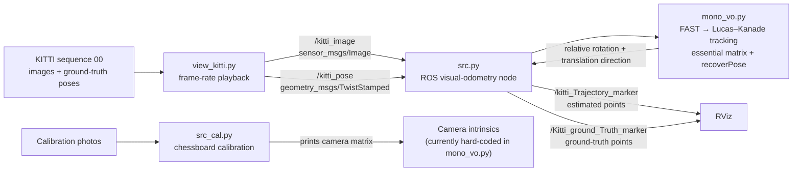

# Monocular Visual Odometry

A ROS-based monocular visual odometry coursework project. It tracks FAST features between consecutive camera frames with pyramidal Lucas–Kanade optical flow, estimates relative camera motion from an essential matrix, and publishes estimated and KITTI ground-truth trajectories as RViz markers.

## Repository layout

```text
.
├── README.md
├── pattern.png                 # Calibration target image
└── src/                        # ROS catkin package (lab4)
    ├── mono_vo.py              # Feature tracking and relative pose estimation
    ├── src.py                  # VO ROS node and trajectory marker publishing
    ├── view_kitti.py           # KITTI image/pose publisher
    ├── src_cal.py              # Chessboard camera calibration utility
    ├── package.xml
    ├── CMakeLists.txt
    ├── dataset/pose/00.txt     # KITTI sequence 00 ground-truth poses
    ├── images/                 # Calibration photos
    └── rviz/                   # RViz configurations
```

The KITTI `sequence/image_0` directory is not present in this checkout. `view_kitti.py` expects the grayscale/color image sequence at `src/dataset/sequence/image_0/` and the pose file at `src/dataset/pose/00.txt`.

## Requirements

- ROS 1 with `rospy`, `cv_bridge`, `sensor_msgs`, `geometry_msgs`, and `visualization_msgs`
- A catkin workspace
- Python packages: NumPy, OpenCV, and Matplotlib (the calibration utility uses OpenCV)
- KITTI odometry sequence 00 images, placed at `src/dataset/sequence/image_0/`

The scripts also assume a KITTI camera calibration (`fx = 718.856`, `cx = 607.1928`, `cy = 185.2157`) in `mono_vo.py`.

## Implementation summary

The project is organized as a small ROS 1 pipeline:

1. `view_kitti.py` reads KITTI sequence images and the matching ground-truth pose rows, then publishes them at the configured frame rate. It publishes images on `/kitti_image` and ground-truth positions on `/kitti_pose`.
2. `src.py` receives each image and compares it with the previous frame. It calls `monoVO` from `mono_vo.py`, then accumulates valid relative rotations and translation directions into an estimated trajectory. It also receives the ground-truth positions for visualization and preliminary error reporting.
3. The nodes publish trajectory points as ROS `visualization_msgs/Marker` messages for display in RViz. Blue points represent the estimated trajectory; green points represent ground truth.
4. `src_cal.py` is a separate calibration utility. It finds a 7-by-6 chessboard pattern in calibration photos and uses OpenCV camera calibration to print an intrinsic matrix.

The visual-odometry calculation uses OpenCV FAST corner detection, pyramidal Lucas–Kanade optical flow to match corners between frames, and an essential matrix with RANSAC followed by pose recovery to estimate relative rotation and translation direction. The camera intrinsics are currently hard-coded to KITTI values. Monocular vision does not provide absolute translation scale, so the accumulated estimate is scale-ambiguous.

### Tools and libraries used

- **Python 3** for the ROS nodes and processing scripts.
- **ROS 1 / rospy** for nodes, parameters, publishers, and subscribers; **catkin** is used as the workspace build system.
- **OpenCV (`cv2`)** for FAST features, Lucas–Kanade optical flow, essential-matrix estimation, pose recovery, image handling, and chessboard calibration.
- **NumPy** for camera matrices and pose-vector operations.
- **cv_bridge** to convert between ROS image messages and OpenCV images.
- **ROS message packages**: `sensor_msgs/Image`, `geometry_msgs/TwistStamped` and `Point`, and `visualization_msgs/Marker`.
- **KITTI odometry sequence 00** as the image and ground-truth pose source; **RViz** for trajectory visualization.
- **Matplotlib** is imported by the scripts, though trajectory plotting is currently unimplemented.

### Data-flow diagram



## Build and run

Place this repository's `src` directory in a catkin workspace's `src` directory, then build and source the workspace:

```bash
cd ~/catkin_ws
catkin_make
source devel/setup.bash
```

The publisher requires a ROS parameter `/fps`; the VO node requires `/lab4/fps`. With the image sequence installed and the workspace sourced, start the nodes in separate terminals:

```bash
rosparam set /fps 10
rosparam set /lab4/fps 10
rosrun lab4 view_kitti.py
rosrun lab4 src.py
```

The scripts currently live directly in the package directory and are not installed by `CMakeLists.txt`; if `rosrun` cannot find them, run them with Python from `src/` after sourcing ROS and the workspace:

```bash
python3 view_kitti.py
python3 src.py
```

`view_kitti.py` publishes `/kitti_image` (`sensor_msgs/Image`) and `/kitti_pose` (`geometry_msgs/TwistStamped`). The VO node subscribes to those topics and publishes `/kitti_Trajectory_marker` and `/Kitti_ground_Truth_marker`. The visualization helper `view_kitti.py` also publishes `/kitti_pose_marker`. RViz configuration files are in `src/rviz/`.

## Current implementation notes

- `mono_vo.py` returns relative rotation, translation direction, and a validity flag based on the minimum tracked-feature threshold. Monocular translation has unknown metric scale, so the estimate cannot directly match metric KITTI positions without scale handling.
- `view_kitti.py` loops over frames 0 through 1000 and therefore expects at least 1001 images and pose rows.
- `src.py` contains ROS callbacks and marker publishing, but `plotTraj` is unimplemented and `computeError` is a placeholder. Its `evaluate_error` routine is present but does not perform a standard aligned ATE calculation; treat its printed value as preliminary.
- `src_cal.py` detects a 7-by-6 chessboard in the JPGs under `src/images/` and prints the resulting camera matrix.

Large dataset archives and ROS bags are not included. Obtain the KITTI images and any course-provided assets from their original source, and check their redistribution terms before publishing copies.
